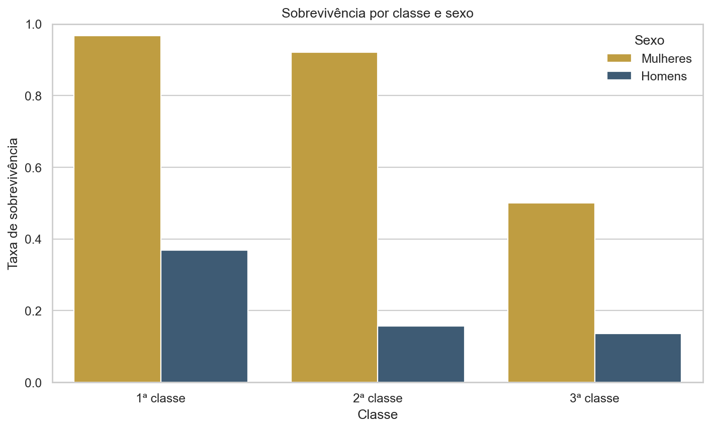
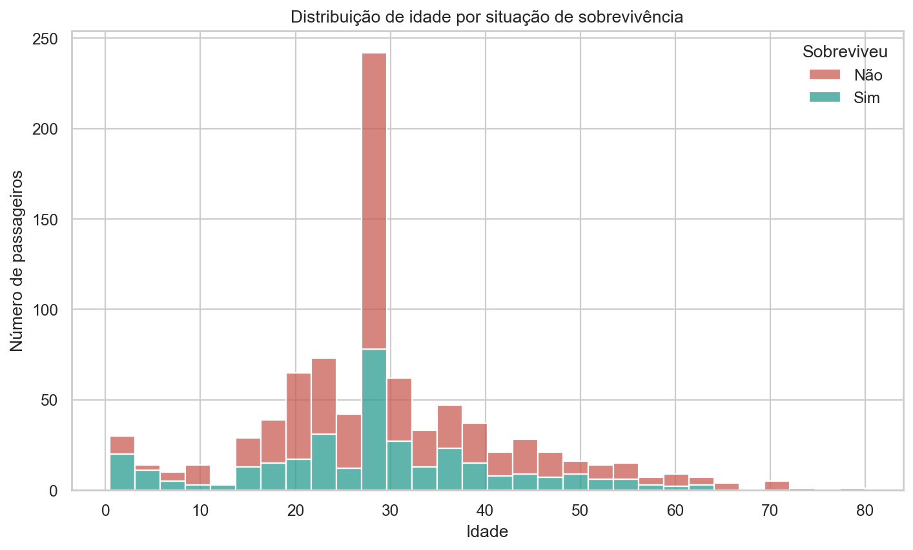
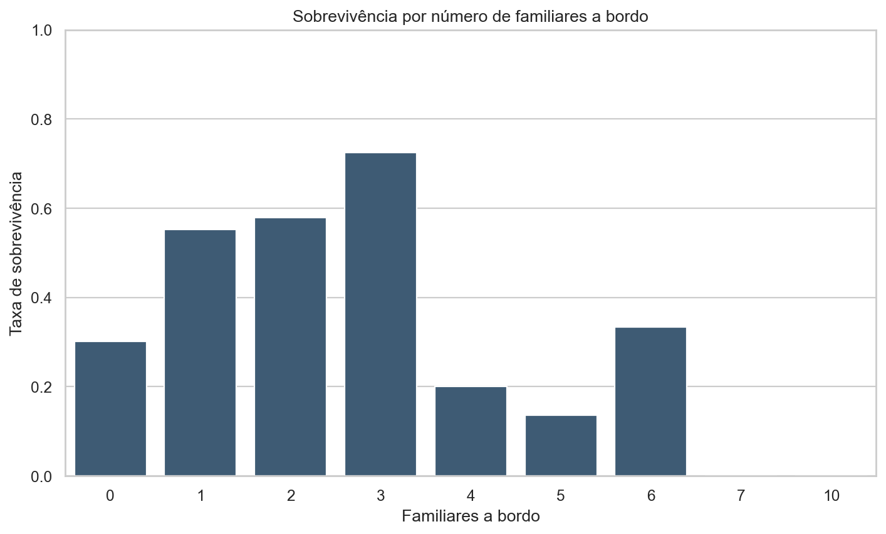

# Análise de Sobrevivência no Titanic

[](https://www.python.org/)
[](https://github.com/rhoneycruz-ui/titanic-analysis/actions/workflows/tests.yml)
[](https://pandas.pydata.org/)

Análise exploratória e reproduzível do dataset clássico do Titanic. O projeto investiga como **classe, sexo, idade e número de familiares a bordo** se relacionam com a sobrevivência dos passageiros.

## Resultados principais

| Passageiros no dataset | Passageiros analisados | Sobreviventes | Taxa de sobrevivência | Idades preenchidas |
|---:|---:|---:|---:|---:|
| 891 | 889 | 340 | **38,2%** | 177 |

- Mulheres da 1ª classe apresentaram a maior taxa observada: **96,7%**.
- Entre mulheres da 3ª classe, a taxa caiu para **50,0%**.
- Homens da 3ª classe tiveram uma taxa observada de **13,5%**.
- Passageiros com três familiares a bordo tiveram **72,4%** de sobrevivência, mas esse grupo reúne apenas 29 pessoas.

Esses resultados são associações descritivas. Eles não demonstram causalidade.

## Visualizações

### Classe e sexo



### Idade e sobrevivência



### Familiares a bordo



## Como executar

Requer Python 3.12 ou mais recente.

```bash
python -m venv .venv
```

No Windows:

```powershell
.venv\Scripts\python -m pip install -r requirements.txt
.venv\Scripts\python analise.py
```

No Linux ou macOS:

```bash
.venv/bin/python -m pip install -r requirements.txt
.venv/bin/python analise.py
```

O comando usa o arquivo `titanic.csv` do repositório e recria automaticamente os três gráficos em `images/`. Não é necessário copiar o dataset nem preparar diretórios manualmente.

Para escolher outros caminhos:

```bash
python analise.py --input caminho/dados.csv --output caminho/graficos
```

## Metodologia

1. Carrega o CSV sem modificar o arquivo original.
2. Preenche 177 idades ausentes com a mediana.
3. Remove a coluna `deck`, que possui muitos valores ausentes.
4. Exclui duas linhas sem porto de embarque.
5. Calcula as métricas sobre os 889 registros restantes.
6. Cria `familia` somando irmãos/cônjuges (`sibsp`) e pais/filhos (`parch`).
7. Gera os gráficos com matplotlib e seaborn.

O código separa carregamento, limpeza, métricas e visualização em funções testáveis. O contrato do dataset e a geração dos arquivos são verificados automaticamente no GitHub Actions.

## Testes

```bash
python -m pip install -r requirements-dev.txt
python -m pytest -q
```

Os testes validam:

- quantidade original e quantidade analisada;
- tratamento de idade e porto de embarque;
- taxa geral e total de sobreviventes;
- cálculo do tamanho da família;
- geração dos três PNGs;
- execução por linha de comando fora da pasta do projeto.

## Estrutura

```text
.
├── analise.py
├── titanic.csv
├── images/
│   ├── distribuicao_idade.png
│   ├── sobrevivencia_classe_sexo.png
│   └── sobrevivencia_familia.png
├── tests/
│   └── test_analise.py
├── requirements.txt
└── requirements-dev.txt
```

## Dados

O repositório inclui uma cópia com 891 passageiros e campos como classe, sexo, idade, tarifa, porto de embarque e sobrevivência.

Referências:

- [Kaggle — Titanic](https://www.kaggle.com/c/titanic)
- [seaborn — Titanic dataset](https://github.com/mwaskom/seaborn-data/blob/master/titanic.csv)

## Limitações

- A análise é exploratória e não treina um modelo preditivo.
- O preenchimento das idades pela mediana simplifica a distribuição original.
- Grupos familiares maiores possuem poucas observações; suas taxas devem ser interpretadas com cautela.
- As associações observadas não estabelecem relações de causa e efeito.

## Tecnologias

Python · pandas · matplotlib · seaborn · pytest · GitHub Actions
