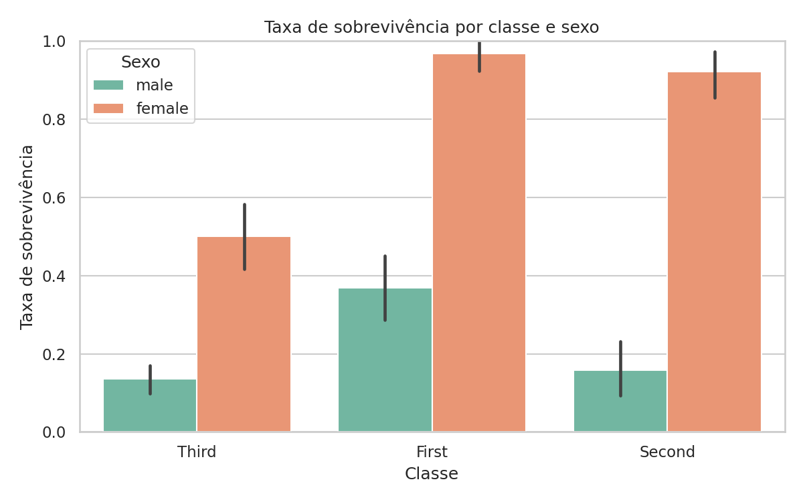
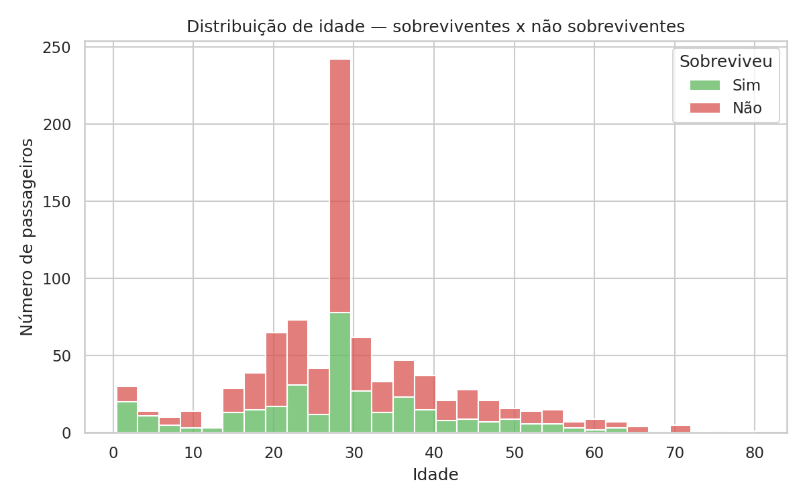
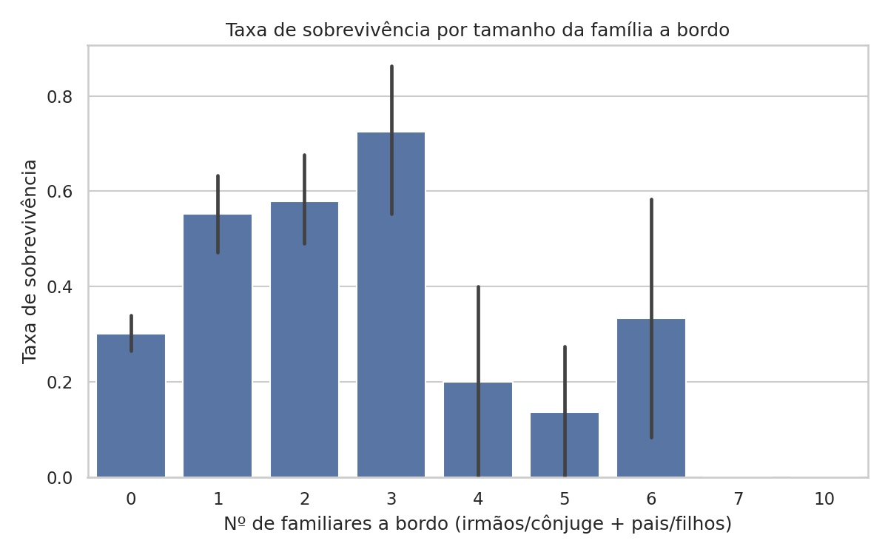

# Análise de Sobrevivência no Titanic

Análise exploratória do dataset clássico do Titanic para investigar como **classe, sexo, idade e tamanho da família** se relacionam com a sobrevivência dos passageiros.

## Resultado

A análise calcula uma taxa geral de sobrevivência de **38,2%** e produz três visualizações:

| Sobrevivência por classe e sexo | Distribuição de idade | Sobrevivência por família |
|---|---|---|
|  |  |  |

Principais observações:

- mulheres da primeira classe apresentam a maior taxa de sobrevivência;
- sexo e classe aparecem fortemente associados ao desfecho;
- grupos familiares pequenos e médios apresentam resultados diferentes de passageiros sozinhos ou de famílias muito grandes.

## Dados

O repositório inclui uma cópia do dataset com 891 passageiros. O conjunto contém informações como classe, sexo, idade, tarifa, porto de embarque e sobrevivência.

Fontes de referência:

- [Kaggle — Titanic](https://www.kaggle.com/c/titanic)
- [seaborn — Titanic dataset](https://github.com/mwaskom/seaborn-data/blob/master/titanic.csv)

## Como executar

Requer Python 3.10 ou mais recente.

```bash
python -m venv .venv
```

No Windows:

```powershell
.venv\Scripts\python -m pip install -r requirements.txt
New-Item -ItemType Directory -Force data, images
Copy-Item titanic.csv data/titanic.csv
.venv\Scripts\python analise.py
```

No Linux ou macOS:

```bash
.venv/bin/python -m pip install -r requirements.txt
mkdir -p data images
cp titanic.csv data/titanic.csv
.venv/bin/python analise.py
```

Os novos gráficos serão gravados em `images/`. As imagens exibidas neste README são os resultados já publicados na raiz do repositório.

## Etapas da análise

1. Carregamento do CSV com pandas.
2. Preenchimento de idades ausentes com a mediana.
3. Remoção da coluna `deck`, que possui muitos valores ausentes.
4. Remoção das poucas linhas sem porto de embarque.
5. Cálculo de estatísticas descritivas.
6. Geração de gráficos com matplotlib e seaborn.

## Tecnologias

- Python
- pandas
- matplotlib
- seaborn

## Limitações

Esta é uma análise exploratória e descritiva. As associações observadas não demonstram causalidade e o projeto não treina nem avalia um modelo preditivo. O preenchimento de idades ausentes pela mediana também simplifica a distribuição original.
